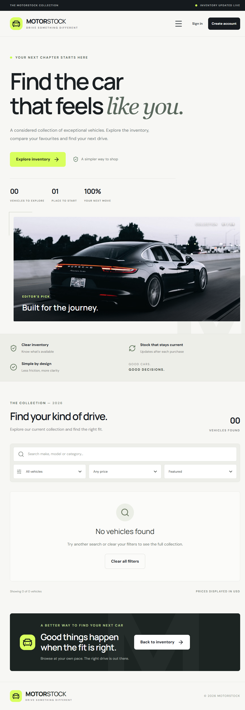

# Motorstock - Car Dealership Inventory

Motorstock is a small car inventory app. A user can create an account, sign in, search for cars, and buy a car. An admin can add cars, change car details, add stock, and delete cars when they have no purchase history.

This project was made for the Incubyte Software Craftsperson Intern assessment.

## What the project can do

- Register and sign in users.
- Protect passwords with secure hashing.
- Use JWT tokens for signed-in requests.
- Show cars from a real database.
- Search by make, model, category, and price.
- Buy one car at a time.
- Stop a purchase when stock is zero.
- Let admins add, update, restock, and delete cars.
- Stop regular users from using admin actions.
- Keep users, cars, and purchases in a database.

## Technologies

- **Python and FastAPI** - build the backend API.
- **SQLAlchemy** - connect the Python code to the database.
- **SQLite** - simple local database. PostgreSQL is also supported.
- **React and Vite** - build the web page.
- **CSS and Tailwind setup** - style the page.
- **pytest** - test the backend.

## Project folders

```text
backend/      FastAPI app, database code, and tests
frontend/     React app
screenshots/  Real screenshots from the running app
README.md     This guide
TEST_REPORT.md Test results
PROMPTS.md    Available raw AI prompt material
```

## What you need

- Windows 10 or 11.
- Python 3.11 or newer.
- Node.js 20 or newer.
- npm.
- Git.
- Docker Desktop is optional. It is only needed for the PostgreSQL option.

## Run the app on Windows

Open two PowerShell windows. Run the backend in the first window and the frontend in the second window.

### 1. Set up the backend

From the project folder:

```powershell
cd backend
python -m venv .venv
.\.venv\Scripts\Activate.ps1
pip install -r requirements.txt
Copy-Item .env.example .env
uvicorn app.main:app --reload
```

If PowerShell blocks the activate command, you can skip activation and use the Python file directly:

```powershell
..\.venv\Scripts\python.exe -m pip install -r requirements.txt
```

The backend runs at `http://localhost:8000`.

The API help page is at `http://localhost:8000/docs`.

The local SQLite file is created at `backend\dealership.db`. It is not committed to Git.

### 2. Set up the frontend

Open a new PowerShell window. From the project folder, run:

```powershell
cd frontend
npm install
Copy-Item .env.example .env.local
npm run dev
```

Open `http://localhost:5173` in a browser.

The frontend uses `http://localhost:8000` by default. You can change this in `frontend\.env.local` with:

```env
VITE_API_URL=http://localhost:8000
```

## Database

SQLite is the default. The app creates its tables when the backend starts. No separate database setup is needed for local testing.

PostgreSQL can also be used. Docker Compose has a local PostgreSQL service:

```powershell
docker compose up -d db
```

Then set `DATABASE_URL` in `backend\.env` to a PostgreSQL connection string. The exact Docker password is in `docker-compose.yml` and is for local use only. Docker and PostgreSQL were not tested as part of the latest checks, so they are not claimed as verified.

## Create an admin account

Normal registration always creates a regular user. A user cannot become an admin by sending a role in the registration request.

First register the account in the app or through the API. Then, with the backend stopped or from another terminal, run this from the `backend` folder:

```powershell
..\.venv\Scripts\python.exe -m app.admin --email your-email@example.com
```

Use the same email that you registered. The command only changes an existing account. It does not create an account or ask for a password.

Start the backend again. Log out and log in again so the new admin role is loaded into the new token.

## Use the app

1. Open the frontend.
2. Select **Register** and create a user.
3. Sign in.
4. Search by make, model, category, or price.
5. Select **Buy** when stock is available.
6. The stock number refreshes after a successful purchase.
7. When stock is zero, the buy button is disabled.
8. Sign in as an admin to see the admin controls.
9. Use the admin panel to add cars, update cars, restock cars, or delete eligible cars.

If a token expires or is not valid, the app clears the local session and asks the user to sign in again. Passwords are never saved in browser storage.

## API list

| Method | URL | Who can use it | What it does |
|---|---|---|---|
| POST | `/api/auth/register` | Anyone | Create a regular user |
| POST | `/api/auth/login` | Anyone | Sign in and get a token |
| GET | `/api/vehicles` | Anyone | List cars |
| GET | `/api/vehicles/search` | Anyone | Filter cars |
| POST | `/api/vehicles` | Admin | Add a car |
| PUT | `/api/vehicles/{id}` | Signed-in user | Update a car |
| DELETE | `/api/vehicles/{id}` | Admin | Delete a car with no purchase history |
| POST | `/api/vehicles/{id}/purchase` | Signed-in user | Buy one car |
| POST | `/api/vehicles/{id}/restock` | Admin | Add stock |
| GET | `/api/health` | Anyone | Check that the API is running |

Example search:

```text
http://localhost:8000/api/vehicles/search?make=Toyota&min_price=5000&max_price=50000
```

The sample UI shows prices in USD. Change the UI text or data if your assessment uses another currency.

## Run tests and build the frontend

Run backend tests from the `backend` folder:

```powershell
cd backend
..\.venv\Scripts\python.exe -m pytest -q
```

Build the frontend from the `frontend` folder:

```powershell
cd frontend
npm run build
```

The backend tests use a temporary in-memory database. They do not change the local `dealership.db` file.

New work should follow this simple test cycle:

1. Write a test that fails.
2. Make the smallest code change that passes.
3. Run the tests again.
4. Clean up the code if needed.

The current repository does not contain enough old commit history to prove that all earlier work followed this cycle. This is stated honestly in `TEST_REPORT.md`.

## Screenshots

This real screenshot shows the empty inventory page while the frontend was connected to the backend:



No fake screenshots are included. More signed-in or admin screenshots can be added after capturing them from the running app.

## My AI Usage

### Tools used

- ChatGPT helped with the first project structure, feature ideas, test ideas, UI work, and explanations.
- Copilot SDK in VS Code helped review the code, fix errors, add tests, improve the frontend, update the documents, run checks, test the real API, and prepare the GitHub submission.

### How AI helped

- It helped split the work into backend, frontend, database, testing, and documentation tasks.
- It helped find missing cases such as bad tokens, bad roles, empty stock, and invalid updates.
- It helped remove demo inventory so the page uses the real API.
- It helped add the admin setup command.
- It helped update loading, error, empty, login-expiry, and purchase messages.
- It helped write and update backend tests.
- I reviewed the changes, ran the tests and build, used the running app, and checked the Git files before pushing.

### What I learned

AI helped me move faster, but I still had to check the code and test the real behavior. I learned more about FastAPI routes, database stock updates, JWT login, admin permissions, and how the React page talks to the API.

Personal reflection to complete before submission:

> [Add a few sentences in your own words about what you learned and what you still want to understand better.]

## Raw AI conversations

See [`PROMPTS.md`](PROMPTS.md). The assessment asks for raw, unedited chats or a verified public chat link. The current file contains genuine excerpts, but not the full conversation export. Add the full material yourself before submission.

## Deployment

Deployment is optional. For a real deployment, use a strong secret, a real production database, HTTPS, safe CORS settings, and environment variables. Never commit `.env` files or database files.
